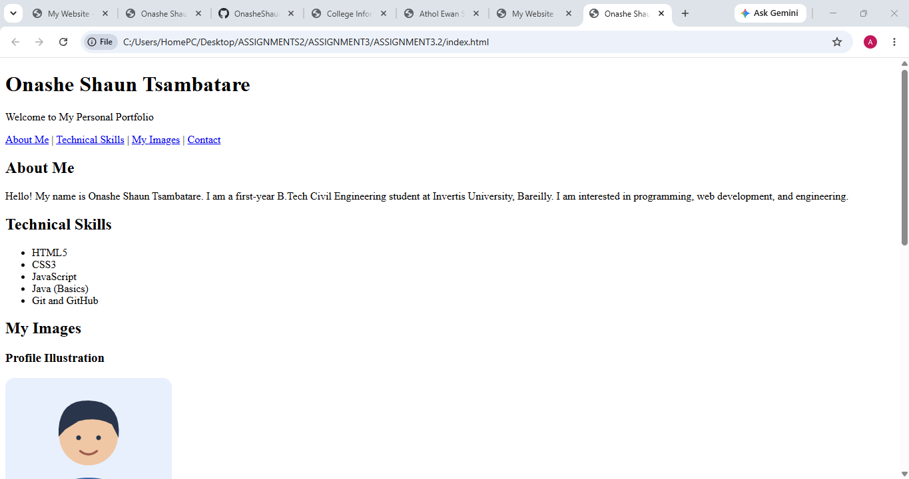

# Assignment 3.2 — Images in HTML

## 1. Aim

To add an images section to a personal portfolio webpage using HTML and learn how to use the `src`, `alt`, `width`, and `height` attributes of the `` tag.

## 2. Requirements

- Visual Studio Code
- A web browser
- Basic knowledge of HTML
- At least three image files
- A project folder containing an `images` directory

## 3. Project Structure

ASSIGNMENT3.2/
│
├── index.html
│
└── images/
    ├── profile.jpg
    ├── coding.jpg
    └── engineering.jpg

## 4.0 Explanation of the Image Attributes

| Attribute | Purpose                                              |
| --------- | ---------------------------------------------------- |
| `src`     | Specifies the location of the image file.            |
| `alt`     | Provides a meaningful text description of the image. |
| `width`   | Sets the displayed width of the image.               |
| `height`  | Sets the displayed height of the image.              |

The image paths are relative to `index.html`. For example, `images/profile.jpg` means the file is inside the `images` folder.

## 8. Result

A personal portfolio webpage was created using HTML with an images section containing at least three images. The `src`, `alt`, `width`, and `height` attributes were implemented, and the image paths were organized using a dedicated `images` folder.

